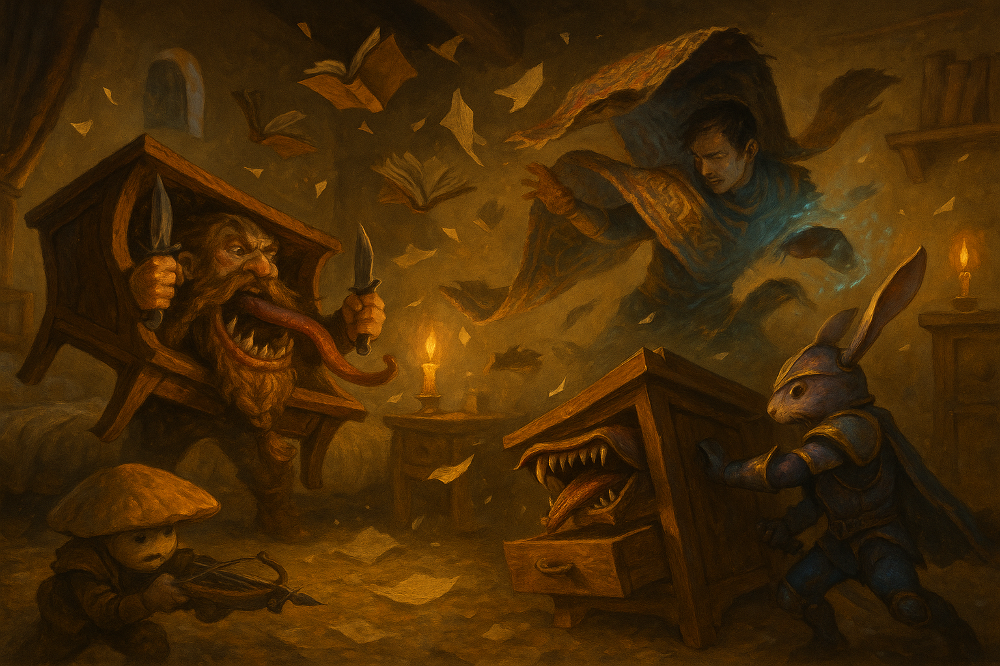

# The Vanished Scholars

*August 11, 2026*

## Overview

In the smoking aftermath of the assault, the party was led into
[the Jade Pyramid](../wiki/locations/the-jade-pyramid.md) to report to
[Empress Serenity](../wiki/npcs/empress-serenity.md)'s council, where the rescue of
the abducted priestess [Naivara Tidewoven](../wiki/npcs/naivara-tidewoven.md) became
[Prance](../wiki/pcs/prance-galavant.md)'s sworn charge — and the University let
slip that four of its brightest students had vanished in the chaos. Following that
trail to the students' sealed dorm, the party tripped the missing diviner's trap: a
mimic, a swarm of animated books, and a smothering rug that very nearly finished
what the invaders had started.

## Key Events

- **Into the pyramid.** [Dalen Marr](../wiki/npcs/dalen-marr.md) and the hooded drow
  [Velra](../wiki/npcs/velra.md) led the party through a blood-keyed door and the
  Jade Pyramid's illusion-warped halls — corridors that fold and mislead — to the
  Empress's war room.
- **The council.** The party met the city's powers all at once:
  [Empress Serenity](../wiki/npcs/empress-serenity.md) and her Goliath bodyguard
  [Horace Steelwinter](../wiki/npcs/horace-steelwinter.md); the wine-soaked
  [Salvatore Danilo](../wiki/npcs/salvatore-danilo.md) of the Lucky Scorpion; the
  arena-owner [Tirakar Sun](../wiki/npcs/tirakar-sun.md); the Bazaar's
  [Tisk Tisk](../wiki/npcs/tisk-tisk.md); the University's
  [Seris](../wiki/npcs/seris.md) and [Raasha Vaad](../wiki/npcs/raasha-vaad.md); the
  Iron Holds' orc [Gorvak Skybinder](../wiki/npcs/gorvak-skybinder.md); and the guard
  leader [Karza Sunhorn](../wiki/npcs/karza-sunhorn.md). Prance introduced the party
  with a booming flourish ("magnificent by necessity — now bow") and was
  immediately, publicly humbled by the Empress.
- **The charge.** With the amulet whispering in his ear, Prance accepted the
  Empress's commission to bring Naivara back — "by blade and by my oath." The party
  won a guard escort in [Krum](../wiki/pcs/krum.md); [Adarius](../wiki/pcs/adarius.md)
  was promised a full University scholarship and a better home for his parents; and
  the Empress laid bare the stakes: without Naivara sanctifying the water, the
  dwindling supply turns deadly, and the attack's timing — on the eve of the
  Festival of the Four Currents — looked deliberate.
- **Four students gone.** Pressed by the Empress, Seris and Raasha Vaad confessed a
  buried worry: four gifted students who shared an off-campus dorm — **Cassian**
  (evocation), **Celine** (divination), **Varicash** (illusion), and **Calus**
  (conjuration) — had vanished without a trace, their rooms showing no struggle and
  no detectable magic.
- **The University's dead.** The party detoured to
  [the University](../wiki/locations/the-university.md), still strewn with corpses,
  where Krum's battered uncle [Holgren](../wiki/npcs/holgren.md) — who had lost some
  nine or ten students and fifteen guards — gave him a **Gorgon-backed bronze
  mirror** that revealed Krum's spectral Phantom self.
- **The trapped dorm.** The "empty" room was warded by Celine's anti-divination
  devices — which is why earlier searches found nothing. As the party investigated,
  the furniture came alive: a **mimic** disguised as a desk, a swarm of **flying
  books**, and a **smothering rug**, all but immune to the party's psychic and charm
  magic. A brutal, unlucky fight followed; Krum and Adarius both dropped
  unconscious and were revived, and the session ended mid-battle, the exhausted
  party finally poised to take its long-overdue rest.

## Memorable Moments

- **"Now bow."** Prance's grandiose presentation of each companion in turn —
  "master of arriving precisely after the fight has begun" — capped by the Empress
  flatly telling him to speak when spoken to.
- **Fizz with the Rizz.** [Fizz](../wiki/pcs/fizz.md) charmed a **26** out of the
  suspicious [Velra](../wiki/npcs/velra.md), who answered by licking his blood off
  her ring-hand and later pressing a dagger to his throat: "you should not trust
  anyone, my dear mushroom — but I think you may be worth my time." He talked Horace
  out of a fistful of healing potions on another 26.
- **The tango.** Prance begged the festival's last dance and drew Horace Steelwinter
  himself, who — on a natural 20 — spun the rabbit-knight so hard he ended up
  tail-up on the floor while Prance flubbed his own step with a natural 1.
- **A salty bedside manner.** Prance treated uncle Holgren's wounds with an "old fey
  remedy" that turned out to be a fistful of salt poured straight into the gash.
- **Death by furniture.** Having survived mummies, suture flies, and fire mephits,
  the party was nearly wiped out by books and a rug — reduced at last to shoving a
  still-thrashing book into a drawer and holding it shut, then having Fizz
  decompose and *eat* the defeated volumes.

## Open Threads

- **Who took Naivara — and why now?** The abduction, the timing against the festival,
  and the missing students increasingly look like one plan, not three.
- **The four scholars.** Why these four — one master of each school? Where did they
  go, and was the diviner **Celine** a victim or a conspirator, given the
  anti-divination wards and lethal guardians left in her own dorm?
- **The Iron Holds' hand.** A promised water shipment never arrived, and the Empress
  openly suspects [Gorvak Skybinder](../wiki/npcs/gorvak-skybinder.md)'s masters of
  striking to make the city dependent. Coincidence, or cause?
- **Salvatore's offer.** [Salvatore Danilo](../wiki/npcs/salvatore-danilo.md)
  whispered a job to [Behnsun Payne](../wiki/pcs/behnsun-payne.md) — "I may have work
  for you." What kind?
- **Loose in the city.** [Tirakar Sun](../wiki/npcs/tirakar-sun.md)'s arena lost
  monsters and prisoners in the attack; they're still out there. And the deserter
  [Charles Dammit](../wiki/npcs/charles-dammit.md) remains unaccounted for.
- **Krum's mirror.** What is the Gorgon-backed glass, and what does the spectral
  double it shows portend?
- **Velra and Fizz.** Trust, appraisal, or a blade waiting to fall?

## The Scene

It had been the longest day of their lives — eighteen hours of mummies and suture
flies and fire that walked like men — and now, in a dead student's candlelit dorm,
the furniture tried to finish them. The desk unhinged its jaw and a grey tongue
lashed out to coil around Krum, hauling the dwarf off his feet and dragging him
into a mouth that stank of old glue and acid; he sawed at it with both daggers and
it only chewed harder. Books rose off the shelves in a fluttering swarm and dove
like paper hawks, spines snapping shut on skulls, and a book — a *book* — cracked
Behnsun across the head hard enough to drop him to one knee. Across the room the
great jade-and-gold carpet peeled itself off the floor and reared up behind
Adarius, and for all his humming and his blade-song footwork it caught him at last
and folded him into its weight, wrapping tight until the world went dark and airless
and his own heartbeat filled his ears.

Nothing worked the way it should. Adarius's shadow-blade sank into the rug and did
nothing — psychic, wasted; Fizz's honeyed suggestions slid off inanimate paper that
could not be charmed; his vicious mockery found a thing with no mind to wound. They
were scattered to the four corners of a room barely wider than a hallway, each
pinned to a different horror, unable to bring their fire to bear on any single one,
and the dice ran cold as the grave — miss after miss after miss while the natural
twenties fell like rain on the other side of the table. Krum went down. Adarius
went down. Prance emptied the last of his *lay on hands* into the dwarf's chest to
drag him back from the edge, then turned and, out of options and dignity both,
simply *grabbed* the book savaging him, wrestled the snapping thing across the room,
and stuffed it into a dresser drawer, sitting on it to keep it shut.

When at last the final volume gave up its stitched-together life, the room fell
quiet but for torn pages settling and five heroes wheezing on the floorboards. Fizz
looked at the shredded rug, the split desk, the drift of ruined books, and — being
a mushroom, and past caring — set about decomposing them, urinating on the lot and
then eating what was left, spores and all. Somewhere in the wreckage was a soft bed
with his name on it. They had survived the sack of a city and the monsters that
sacked it; they had, very nearly, been killed by a library. "Hope y'all had a good
time," the room seemed to say, "despite getting your ass whooped by furniture." They
found the beds, and they slept.
