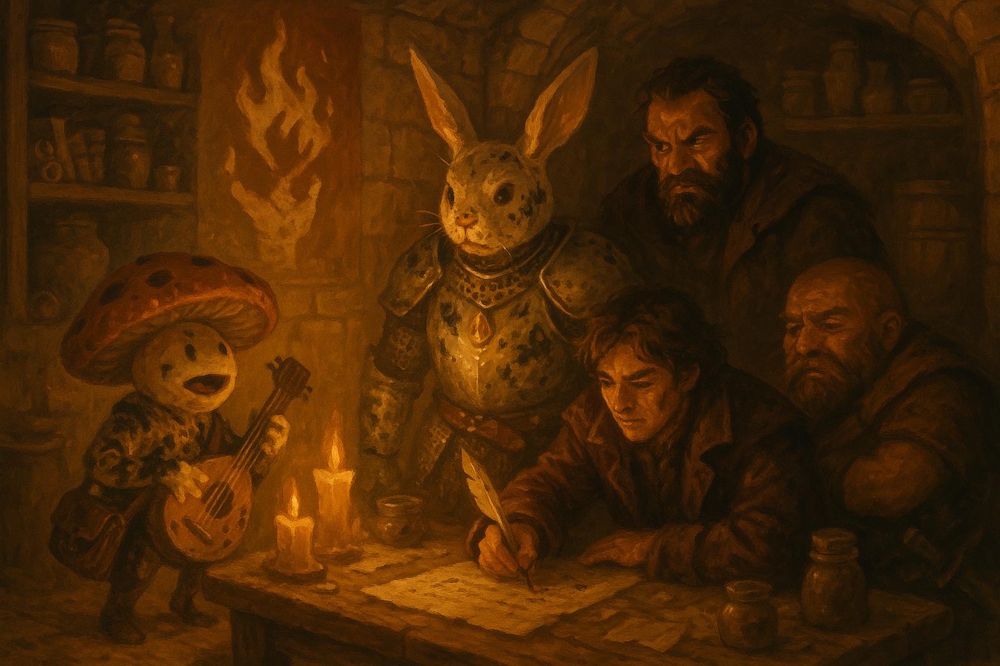

# The Undying Four

*September 2, 2026*

## Overview

The party finally got its long rest — in the dead students' own beds — then found
the trapdoor hidden under the wreckage of the mimic and went down into
[the Undercroft](../wiki/locations/the-undercroft.md) beneath the dorm. What they
found there was not four kidnapped scholars but a cult cell: a fire-hoarding
shrine to [the Undying Flame](../wiki/factions/the-undying-flame.md), a legend
that reaches back before the founding of the city, and a name —
**[the Redstone Narrows](../wiki/locations/redstone-narrows.md)**. Rather than
hand any of it to a court they no longer trust, they forged a letter in the
missing students' own hand and set a trap for whoever comes to answer it.

## Key Events

- **A twenty in the wreckage.** Picking through the shattered desk,
  [Krum](../wiki/pcs/krum.md) turned up a **hatch in the floor** and a shimmering
  **potion of invisibility**. Nobody could open the hatch that night — exhausted,
  he nearly snapped his own thieves' tools on it — so the party barred the door,
  [Adarius](../wiki/pcs/adarius.md) stabbed a hand-written *do not disturb* into
  it with a knife, and they slept: shadow puppets from
  [Prance](../wiki/pcs/prance-galavant.md), a tired little tune from
  [Fizz](../wiki/pcs/fizz.md)'s lute, and eighteen hours of hell finally behind
  them.
- **Down the hatch.** In the morning Prance and Fizz hauled the hatch open
  together and dropped into a cold, candle-lit warren of stone running off toward
  the women's dormitories — "a very dark study hall," as Prance put it. It was, as
  Adarius noted, exactly the sort of place people go when they want to practice
  the one school the University forbids.
- **"Behold."** Prance announced the party at the door, and a **robed wooden
  mannequin** came off its stand swinging a staff. Krum put a crossbow bolt
  between the rabbit's ears and into its hood;
  [Behnsun](../wiki/pcs/behnsun-payne.md) opened with *true strike* and warned
  everyone off charm and psychic magic; Prance slid under the staff, judo-threw
  the thing flat and demanded it tell him where the students had gone. It had
  nothing to say and headbutted him with the arrow still sticking out of it.
  Behnsun finished it with an empowered second-level *chromatic orb* of fire —
  24 damage — and the guardian dissolved into ash, taking Prance's only "contact"
  with it.
- **The cult beneath the college.** The Undercroft held a table of dissected
  suture flies, chests of plain spell components, barrels of **bat guano** (Fizz
  ate some and correctly identified it as *fireball* material), coded notes no
  one could read, and — painted on the wall — a **white skeletal hand clenching a
  flame**.
- **The sigil, and the grudge behind it.** Prance held the amulet up to the
  painting and the [Amulet Speaker](../wiki/npcs/the-amulet-speaker.md) knew it at
  once: *"I thought it might be him. This old so-and-so, never could let it go.
  He's always been jealous of me and my lover."* Adarius's history check filled in
  the rest — the myth of **the Undying Flame**: two great powers contesting an
  elven woman of the desert before the city existed, the winner fathering on her a
  daughter, half genie and half elf, with blue translucent skin. That daughter is
  [Naivara Tidewoven](../wiki/npcs/naivara-tidewoven.md). The abduction is not
  about water. It is the loser of that contest, collecting.
- **Redstone Narrows.** Behnsun's natural 20 on the suture fly corpses yielded
  notes on binding the creatures through a psychic link to an alpha — worth a
  permanent **+2 to attack rolls against suture flies for the whole party**. And
  Adarius, working through the coded script under *comprehend languages*, pulled
  out one legible phrase: **the Redstone Narrows** — the tar country where
  Behnsun's recon unit had once been sent to free slaves, and where Adarius
  himself was made to labour as a boy.
- **The lie.** Nobody wanted to hand this to the Empress's council. Fizz's plan
  won the table: write a note **as the four missing students**, saying the
  outsiders have forced a change of plan, and summon whoever is left to the
  **Lucky Scorpion** — no mention of the Narrows, a black bandana on the right arm
  as the recognition sign, and a signature: *the Undying Four*. Deception, with
  the whole party helping and a bardic die on top, came out at a solid 16.
- **V for Varrek.** Leaving the dorm, the door they had barred behind them lit up
  with a **glyph of warding** laid while they slept. A great **V** flashed in the
  circle and blasted all five of them ten feet across the campus grounds — 21
  damage to those who failed, 10 to those who saved.
  **[Varrek Ashtongue](../wiki/npcs/varrek-ashtongue.md)**, the missing illusionist,
  had been near enough to touch them in the night.
- **Uncle Holgren.** Blown out onto the lawn, they were met by
  [Holgren](../wiki/npcs/holgren.md), who fussed over his nephew, produced two
  bottles of cinnamon whiskey instead of the healing potions they asked for
  (*"What am I, an alchemist, boy?"*), and shared what more he knew of
  [Celine](../wiki/npcs/celine.md) — a quiet, capable student whose grades had
  slipped after she was passed over for the festival's fireworks committee. Fizz's
  insight read him as genuinely worried and nothing worse; Prance's read got
  nothing at all. Krum lied to his uncle's face to keep him out of it and then had
  to defend him to his own party.
- **Bait on the board.** On the University message board Fizz posted a forged
  notice summoning Varrek Ashtongue to the library after the funeral services, to
  collect a certificate for his mastery of the warding arts. Adarius, still sore
  about the door, posted his own beside it: *Varrek Ashtongue is a tuul.*

## Memorable Moments

- **Death by furniture, part two.** "Hey — at least we only had to fight a
  mannequin this time."
- **The band name.** An entire session of running auditions for what to call
  themselves: Freddie and the Long Necks, the Long Shanks, **Mousewood**, Chariots
  of Fire, the Book Burners, Fizz and the Funky Bunch, and — from Krum, after the
  glyph — *the nonperceptive four*. They settled on nothing, and resolved to
  change it every couple of sessions to throw everyone off.
- **Ink to ear.** Prance decided the cult sigil could be defeated with a bottle of
  black ink, climbed onto Fizz's shoulders to reach it, rolled a 2, and put them
  both flat on the floor — a white rabbit and a mushroom, black from ear to tail,
  for the rest of the day.
- **"This is my daughter."** The amulet, done being a prop: *"This isn't some
  play, rabbit boy. This isn't some grand opera."* Prance promised to save her at
  the most advantageous moment for the story, and felt the amulet's power pulse
  and weaken in his hand.
- **Freddie was a giraffe.** A confession Fizz believes in his soul, and which has
  turned him decisively against "mother" — with a follow-up whisper Fizz did not
  ask for: *"Why does it have to be Prance's tale of glory? Why can't it be
  yours?"*
- **The worst intimidation check ever rolled.** Adarius's message-board threat
  came out in the handwriting of an angry five-year-old, backwards letters and
  all — and he blamed the whiskey.
- **A kiss on the forehead.** Holgren pulling his lying, exhausted nephew into a
  hug: *"You're never too old for that, boy."*

## Open Threads

- **Who answers the letter?** The bait is set for the Lucky Scorpion — black
  bandana, right arm. If somebody in the Empress's court is passing information to
  the cult, they will walk in wearing it.
- **Varrek is still here.** He was inside their room, or near it, while they
  slept. The library notice may draw him out after the funerals — or tell him
  exactly how close the party is.
- **The Redstone Narrows.** Tar, slavers, and both Adarius's childhood and
  Behnsun's old recon unit. The party intends to go, and intends to tell the court
  nothing about it.
- **Old so-and-so.** The Undying Flame's true name has never been known, and the
  amulet cannot speak it — the word comes out muffled every time.
- **Was Celine recruited or grieved into this?** Passed over for the fireworks
  committee, grades slipping, keeping to herself — and then a shrine to a fire god
  under her floor.
- **Is Holgren clean?** Fizz says yes with a 19. Prance's 4 says only that he
  cannot tell whether the old dwarf is the smartest man in the world or valiantly
  playing the fool. Krum is certain, which is its own kind of exposure.
- **The amulet's price.** Its power is not unconditional. Prance has been told
  plainly what it costs, and has already answered wrong once.

## The Scene

The candles in the dead students' study had burned down to stubs, and the whole
room smelled of guano and old ink. Fizz paced the length of it with his hands
behind his back, still tacky with black from the sigil he and Prance had failed to
blot out — a mushroom and a rabbit-knight, both of them inked from ear to tail,
neither willing to be the first to mention it again. "What are they most afraid
of?" he said, to nobody, to Freddie, to the ceiling. "They're afraid of losing
their water. They've already lost their priestess. So we don't tell them a thing
they can check. We tell them a thing they have to *answer*." Behind him Adarius
laid a fresh sheet of note-parchment flat on the table and dipped a quill, and
Krum, who had said almost nothing since the argument about his uncle, folded his
arms and watched the door.

They wrote it as the students. *The outsiders have come to town. The water
priestess has been taken, as planned. With these outsiders, the plan must change —
meet us at the Lucky Scorpion.* No mention of the Narrows; Adarius was immovable
on that, and nobody argued. A black bandana on the right arm so they would know
each other, since none of them knew what the students looked like. Prance leaned
in and asked, with enormous dignity, whether the note might say *Prance and his
valiant friends*, and was talked down by a mushroom with both hands on his
shoulders: *buddy, I love you, but we cannot tell the bad guys who is coming.* The
amulet at his ear said yes. Freddie, in the satchel, suggested Mousewood, was
ignored, and flopped over onto his side to sulk. And at the bottom, in a hand that
was not theirs, they signed it: **the Undying Four**.

It was, everyone agreed, a hell of a thing for a party that could not decide on
its own name. Chariots of Fire. The Book Burners. Fizz and the Funky Bunch. Krum
offered *the nonperceptive four* and got no argument he could respect. Somewhere
above them a door they had barred was already glowing with a ward laid while they
slept, and a dragonborn illusionist who had stood close enough to touch them in
the dark was waiting to see what they would do next. They rolled the parchment,
put out the candles, and climbed the ladder to go and lie to an empress — five
exiles, filthy, half-healed, and for the first time since the city fell, a full
step ahead of somebody.
