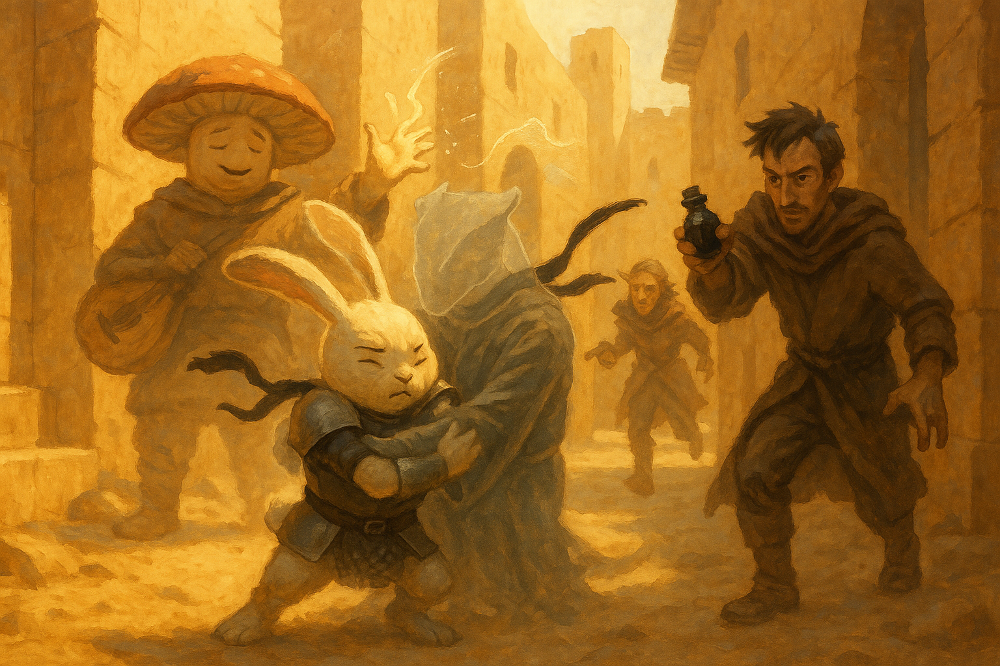

# Varrek's Very Bad Day

*October 13, 2026*

## Overview

With the funerals still hours off, the party flipped a die between the council and
the library, and the die said library. There they arrested the wrong man, searched
the wrong student, and then walked straight into the right one:
[Varrek Ashtongue](../wiki/npcs/varrek-ashtongue.md), invisible and waiting to
spring a trap of his own. Two captures, one chase through the streets, and a
*suggestion* spell later, the party had what the cult's coded notes never gave
them — a name. [The Redstone Narrows](../wiki/locations/redstone-narrows.md) hide
the entrance to the lair of **[Sicovax](../wiki/npcs/sicovax.md)**, leader of
[the Undying Flame](../wiki/factions/the-undying-flame.md), and what he wants with
the water priestess is revenge.

## Key Events

- **Council or library.** The vote split down the middle and was settled by a
  die: odd, library. The plan was to get there well before the two o'clock funeral
  services and lay a trap for whoever came to answer the forged notice. Prance tied
  a black bandana on his right arm — and, on Fizz's advice, a second one beneath
  it, "to really make it pump."
- **The arrest of Bartleby.** The University library was nearly empty: a few
  students and one very old librarian,
  [Bartleby](../wiki/npcs/bartleby.md). Prance asked him about Ashtongue, the
  Undying Four, and death cults in quick succession; the old man cleaned out his
  ear to be sure he had heard right and went white. Prance decided this was guilt,
  declared him "this mild-mannered librarian, so-called," and had Krum cuff him
  like a city watchman. *"Boy, why are you arresting me? Do I need to tell your
  uncle about this?"* A request for the library's lending records, made with the
  man still in an armlock, got the answer it deserved: come back with a writ from
  a captain of the guard.
- **Something moved.** While the other two were busy with the librarian, Fizz and
  Behnsun both caught it — a noise, and a table that shifted by itself. Fizz put a
  crossbow bolt into a potted bush. Behnsun, who likes books too much to throw
  fire in a library, sent *mage hand* to tug at the table. Nothing.
- **The wrong student.** A student squeezed past the crowd in the aisle, and Fizz
  — certain they had just been pickpocketed — paid him a gold piece for the
  privilege of searching him. He had a library card and some cheap spell
  components. He also had a class with Varrek: a braggart who signs every spell he
  casts with a big **V**, and whom nobody had seen in days.
- **"Do not force me."** Prance turned to the stacks and announced that his arch
  wizards would reveal the intruder by force. Something answered with a noise, and
  initiative was rolled. Behnsun raised *mage armor*, walked toward the sound, and
  bumped into a scaly claw. Prance ran to the double doors and shut them at his
  back. Krum slashed at empty air with both daggers and both came away red.
- **Out of the air.** Behnsun pointed out that an invisible man who has just been
  stabbed twice ought to have lost his concentration, and the brass dragonborn
  flickered into view just in time for Fizz's *vicious mockery* about student
  hygiene. Varrek *misty stepped* to the doors and tried to slip past Prance, who
  tightened his bandana and did not move. (*"That's not even a thing we do,"* said
  Varrek, of the bandana. *"That's something y'all made up."*) Adarius tried
  *charm person* — "Lad, the intent isn't to kill you" — and met a natural 20.
  Bartleby, free at last, fled for the door with a hand to his ear and a whispered
  spell. Prance wrapped the dragonborn up in a grapple and that was that.
- **The questions.** Varrek admitted he had come early to turn their trap into
  his. Fizz talked the fire back down his throat; Behnsun turned out his pockets
  (seven gold and, yes, a library card); Prance complimented his laugh and was told
  they could be the best of friends. Asked who the Undying Four were, Varrek had no
  idea — *"We never called ourselves that. We're just members of the Undying
  Flame"* — and the flame began to gather under his snout again.
- **Suggestion.** Fizz cast *suggestion*: answer our questions truthfully. Varrek's
  eyes went slack. The words cost him — fire burned in his mouth as he spoke, and
  he coughed blood across Fizz's face — but they came. The Redstone Narrows are
  *"where the entrance to where Sicovax resides is."* Sicovax is the leader. What
  he wants with [Naivara](../wiki/npcs/naivara-tidewoven.md) is **revenge**; on
  Prance's chest, the amulet thrummed. The other three students, he supposed, had
  fled, and he did not know where.
- **A sliver of daylight.** Fizz was weighing "one more dead student on today's
  funeral pyre" aloud when two city guards, summoned by Bartleby, pushed the doors
  open. *Misty step* needs only a word. Varrek was thirty feet down the street
  before anyone had turned around.
- **The chase.** Adarius threaded a *fire bolt* down an alley and hit — *"Adarius,
  is that you, boy?"* Fizz's first *sleep* came up short. Krum's crossbow found
  him. Fizz offered to pay his tuition. Behnsun's *chromatic orb* took fifteen more
  out of him and Prance rabbit-hopped the gap, so when Varrek went invisible again
  and tried to run past, the rabbit closed his arms on nothing and held it. The
  second *sleep* rolled 31 — one point more than Prance had left — and the thing in
  his arms went limp and became a dragonborn again.
- **What to do with him.** Bound, gagged, and guarded by a wizard who knows *misty
  step* when he hears it. The two guards caught up, saw through Krum's story
  entirely, and were then stopped dead by Behnsun juggling — they were tabaxi —
  and sent to watch the rear. The argument that followed was the session's real
  fight: Fizz wanted Varrek dead in the alley, before a traitor on the council
  could set him loose; Prance wanted him alive, and his masters warned, for the
  sake of a better final battle; Krum would not kill a kid; Behnsun pointed out
  that guards had watched them chase him. The compromise: show the council the
  forged letter and nothing else, keep Varrek hidden under Adarius's eye, and
  after the meeting hand him to
  [Velra Nighthollow](../wiki/npcs/velra-nighthollow.md) — the one councillor who
  trusts nobody either.

## Memorable Moments

- **The heart check.** With Krum's arm across his chest and a rabbit shouting
  about sacrificed students, Bartleby was made to roll a Constitution save to see
  whether he simply died on the spot. He passed.
- **"I like books."** Behnsun, asked why he did not just firebolt the suspicious
  table.
- **Darn kids.** Varrek, pinned: *"I would have gotten away with it if it wasn't
  for you."*
- **Home security.** Prance: "You tried to kill me this morning, while I was
  taking a nap." Varrek: *"What's wrong with home security?"*
- **Hugging himself.** For one full round the party watched Prance bear-hug an
  empty patch of street while invisible hands pulled his ears apart and something
  called him a *wascally rabbit*. Adarius stood by with a bottle of ink, ready to
  pour.
- **The jugglers' weakness.** A deception check of 5, rescued by a sorcerer
  producing balls from nowhere and a performance of 19. *"That's how you get
  them."*
- **Freddie's review.** In Fizz's pocket: *"Why does this rabbit get to be the
  hero of all his tales? It should be you. I feel like you saved the day."* Fizz
  intends to spend that goodwill later.
- **Not feeling very fizzy.** Krum, quietly, after the mushroom's third argument
  for murder. Fizz allowed that reading everyone's minds may be making him
  cynical — or that it may be mother's magic at work.

## Open Threads

- **The council meeting.** Held over for next time. The party will present the
  letter — the Lucky Scorpion, the black bandana, *the Undying Four* — and watch
  the room for a flicker of recognition. They trust
  [the Empress](../wiki/npcs/empress-serenity.md) and
  [Horace](../wiki/npcs/horace-steelwinter.md), do not trust
  [Salvatore Danilo](../wiki/npcs/salvatore-danilo.md), who owns the Lucky
  Scorpion, and like the two arcane councillors least of all.
- **A prisoner nobody can agree on.** Varrek is alive, gagged, and hidden. Whether
  he is handed to Velra, shown to the council, or quietly never seen again is
  settled for now and not for long.
- **Sicovax.** A name at last for old so-and-so, and an address: somewhere past an
  entrance in the Redstone Narrows.
- **Something is holding his tongue.** Varrek burned from the inside for answering.
  Whatever binds the cult's members to silence, a *suggestion* was only just
  stronger than it.
- **Three still missing.** Cassian, [Celine](../wiki/npcs/celine.md) and Calus —
  fled, by Varrek's guess. He did not know where, and he was not able to lie.
- **Bartleby.** An innocent old man was manhandled in his own library and then
  called the guard. He knows Krum's uncle.
- **Fizz.** The mushroom who measures success in friends argued for an execution
  three separate ways. Frederick approves.

## The Scene

The street behind the University ran narrow between sandstone walls, hot with
noon and smelling of dust and scorched scale. Somewhere in it was a brass
dragonborn with a crossbow bolt in his shoulder and a hole burned through his
robe, and nobody could see him. Prance had come down out of the air ahead of the
others, sixty feet at a sprint and ten more in one long harengon bound, and
landed square in the mouth of the alley with his arms spread like a man about to
embrace an old friend. He heard the footsteps before he understood them. He
closed his arms on nothing, and the nothing was warm, and heavy, and furious.

"Let go of me! Let *go* of me!" The voice came from six inches in front of his
nose. Claws he could not see found his ears and hauled them in opposite
directions. To the rest of the party, arriving out of breath, it looked like the
great Prance Galavant had been overcome in the street by a sudden fit of
self-regard: a white rabbit in split mail, black bandanas knotted on his arm,
hugging himself and shaking, his ears straining apart as if in a high wind. "You
wascally rabbit," hissed the air. Adarius, who had seen stranger things at that
school, uncorked a bottle of ink and waited for a clear shot. "I have him under
control," said Prance, through his teeth, with enormous dignity. "He's not going
anywhere."

Fizz came up last, crossbow lowered, out of patience and nearly out of magic. He
had offered the boy gold, mercy, and a semester's tuition, and been answered with
a mouthful of blood. He raised one hand and spent what he had left. The spell
rolled down the alley like warm water, looking for the weariest thing in it, and
for one long moment it could not decide: Prance's eyelids drooped, his knees
loosened, and the fight went out of his grip. Then the weight in his arms sagged
first. Colour ran back into the empty air — brass snout, singed robe, a slack and
snoring jaw — and Varrek Ashtongue, illusionist, signatory, and the unluckiest
student in Utsa Paradisa, slid gently down the front of a rabbit and onto the
stones. Prance looked at him. Then he looked up, and started working out how to
tell it.
